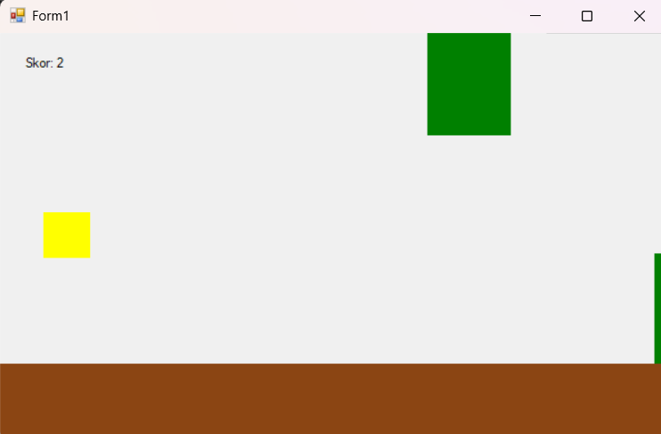
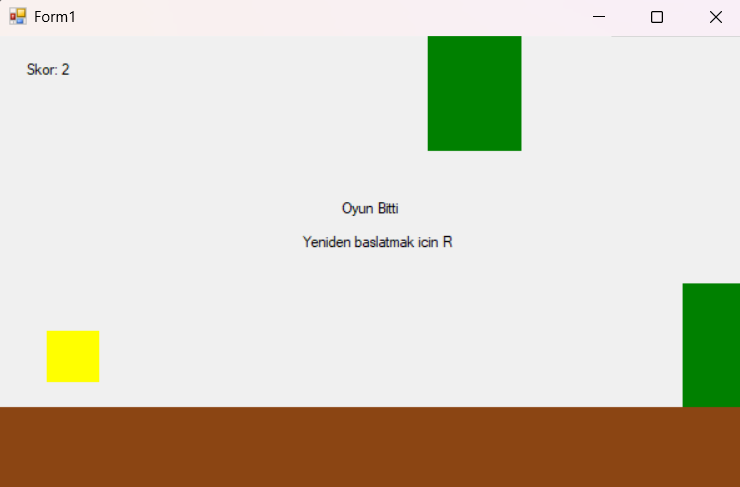

# YMH219-FlappyBird

Bu proje, Nesne Tabanlı Programlama dersi kapsamında C# ve Windows Forms kullanılarak geliştirilmiş Flappy Bird benzeri bir masaüstü oyunudur.

## Kullanılan Teknolojiler
* C# / .NET (Windows Forms)
* `System.Windows.Forms.Timer`
* Klavye Olayları (`KeyDown`, `KeyPreview`)

## Kurulum ve Çalıştırma Adımları
1. Depoyu bilgisayarınıza klonlayın:
   `git clone https://github.com/yalper02/YMH219-FlappyBird.git`
2. Proje klasöründeki `.sln` dosyasını **Visual Studio** ile açın.
3. Çözümü derleyip **Başlat (`F5`)** komutuyla uygulamayı çalıştırın.

## Temel Özellikler
* Yer çekimi etkisiyle düşen ve `Space` tuşuyla zıplayan oyuncu kontrolü.
* Sağdan sola hareket eden ve ekran dışına çıktığında yeniden konumlanan engeller.
* Engel, tavan ve alt sınır çarpışma kontrolü ile `Game Over` durumu.
* Skor sayacı ve `R` tuşu ile oyunu yeniden başlatma özelliği.

## Ekran Görüntüleri
### Oynanış Ekranı

### Oyun Bitti Ekranı

## Bilinen Sınırlamalar / Geliştirme Notları
* Oyun basit 2D `PictureBox` kontrolleri ve tek boru çifti mantığıyla çalışmaktadır.
* İlerleyen aşamalarda yüksek skor kaydı veya farklı zorluk seviyeleri eklenebilir.

## Öğrenci Bilgileri
* **Ad Soyad:** Yiğit Alper Ayhan
* **Öğrenci Numarası:** 250542014